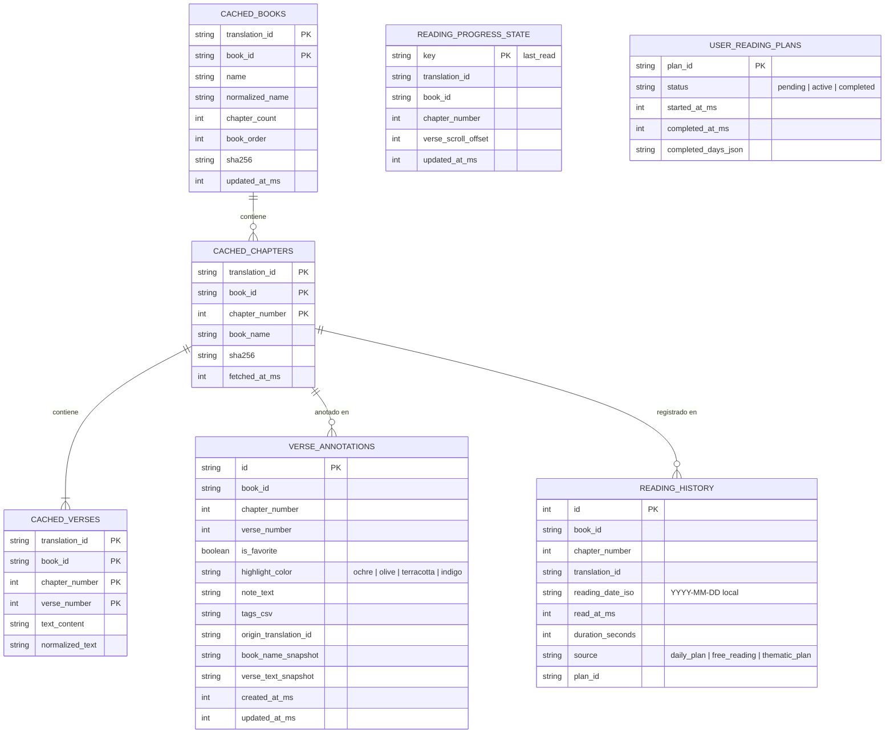
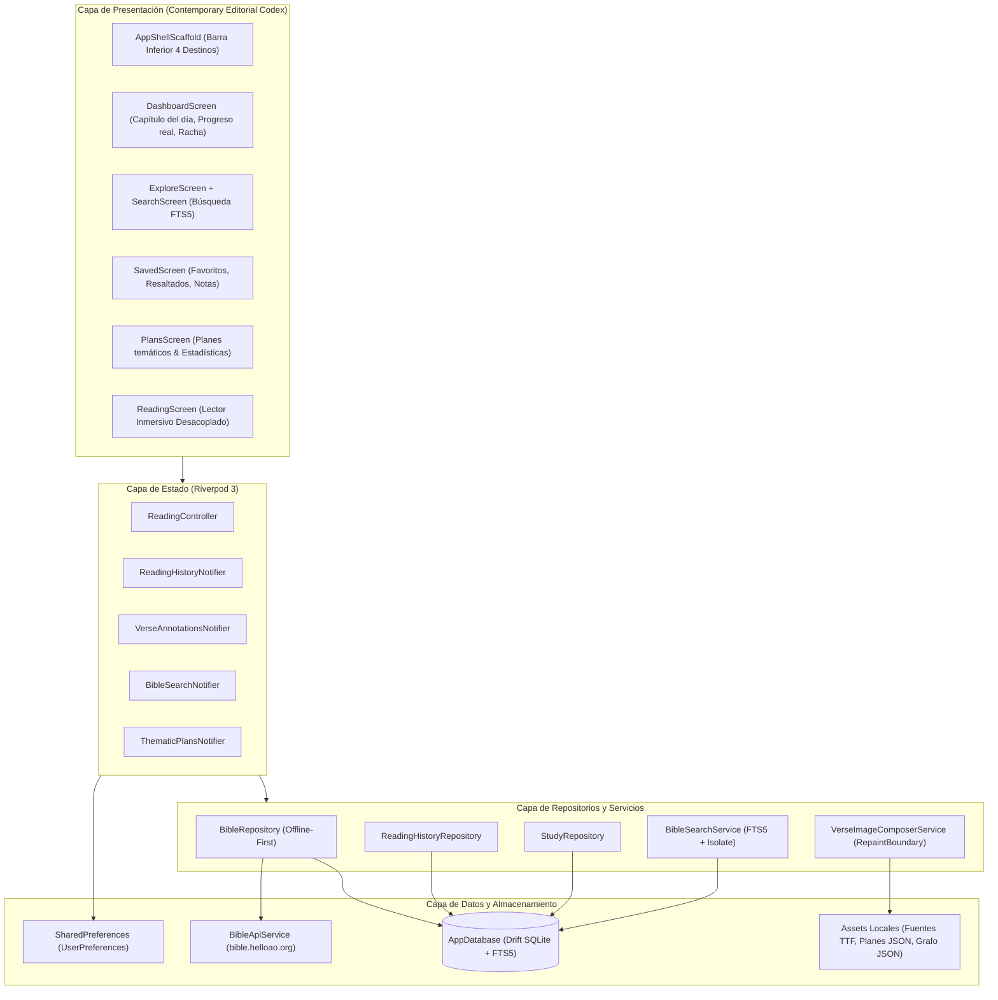

# ARCHITECTURE PROPOSAL — bible_app 1.0

## 1. Decisión de Persistencia Local: Drift (SQLite) vs SharedPreferences vs Isar

### Análisis Comparativo

| Dimensión Técnica | SharedPreferences (Actual) | Isar / Hive (NoSQL) | **Drift + sqlite3_flutter_libs (Recomendado)** |
|---|---|---|---|
| **Consultas relacionales complejas** | Inviable (forzaría decodificar miles de JSONs en RAM) | Soporte limitado a índices manuales | **Nativo y tipado en Dart 3** (agrupaciones, joins, conteos canónicos) |
| **Búsqueda de texto completo (FTS)** | Búsqueda secuencial `contains()` (lenta en >31.000 versículos) | Sin soporte FTS estándar | **SQLite FTS5 nativo** (`unicode61 remove_diacritics 2`) con respuestas `<20 ms` |
| **Streams reactivos con Riverpod** | Polling o notificación manual | Streams propios | **Streams nativos `watch()`** que alimentan directamente `StreamProvider` |
| **Compatibilidad Android 15+ (16 KB pages)** | N/A | Problemático en NDK desactualizado de Isar | **Garantizada** mediante `sqlite3_flutter_libs` oficial |
| **Estrategia de migraciones** | Frágil | Compleja entre esquemas | **`MigrationStrategy` tipada** con suite de tests de migración |

### Arquitectura de Persistencia Dual
- **`SharedPreferences`**: Exclusivamente para configuración ligera y de arranque (`UserPreferences`, hora de notificación, ID de traducción activa, flags de onboarding).
- **`Drift` (`AppDatabase`)**: Motor relacional en disco para el catálogo de libros, caché offline de capítulos, versículos, índice FTS5, favoritos, resaltados, notas, historial de lectura y progreso de planes.

---

## 2. Modelo Relacional de Datos

### Principio de Coordenadas Agnósticas de Traducción
Las anotaciones del usuario y el historial se indexan por la tripleta lógica canónica:
$$\text{Clave Canónica} = (\text{book\_id}, \text{chapter\_number}, \text{verse\_number})$$
utilizando los códigos estándar USFM (`GEN`, `PSA`, `MAT`, `ROM`, etc.).
- Si el usuario resalta `JUAN 3:16` leyendo en `spa_rvg` y luego cambia a `spa_blm`, el resaltado permanece visible en el texto de la nueva traducción.
- En caso de libros deuterocanónicos exclusivos de `spa_blm` (`TOB`, `JDT`, etc.), al cambiar a `spa_rvg` la anotación se conserva intacta en la pantalla de Guardados con su `verse_text_snapshot` y una insignia editorial *"Disponible en edición católica"*.

---

## 3. Arquitectura en Capas y Flujo Reactivo

---

## 4. Política Cache-First y Recuperación sin Conexión

1. **Consulta de Catálogo de Libros**:
   - `BibleRepository.fetchBooks(translationId)` lee de la tabla `CACHED_BOOKS`.
   - Si existen registros, devuelve los libros en tiempo de ejecución de $0\text{ ms}$.
   - En segundo plano, si hay conexión y pasaron $>7\text{ días}$, verifica `translation.sha256` para detectar posibles actualizaciones del texto.
2. **Consulta de Capítulos**:
   - `BibleRepository.fetchChapter(translationId, bookId, chapterNumber)` busca en `CACHED_CHAPTERS` y `CACHED_VERSES`.
   - Si existe en SQLite, lo entrega sin tocar la red.
   - Si no existe, descarga desde `BibleApiService`, ejecuta una inserción en lote en SQLite e indexa automáticamente en la tabla virtual FTS5.
   - **Pre-fetch proactivo**: Al abrir un capítulo con conexión activa, encola en segundo plano la descarga del capítulo siguiente ($N+1$).
3. **Descarga en Lote Opcional**:
   - Para usuarios que desean garantizar funcionamiento total sin conexión o búsqueda instantánea en los 66/73 libros, la pantalla de Ajustes y Búsqueda ofrece la opción *"Descargar traducción completa (~1,5 MB comprimido)"*.
   - El archivo `complete.simple.json` se procesa dentro de un `Isolate.run()` para no bloquear la interfaz y se persiste en una sola transacción SQLite.

