# PRODUCT ROADMAP — bible_app 1.0 & Beyond

## 1. Visión y Propuesta de Valor

**Propuesta de valor rectora:**
> *«Un capítulo al día sin fricción».*

`bible_app` es una aplicación móvil desarrollada con Flutter y Dart 3, orientada a la lectura devocional diaria y al estudio bíblico contemplativo. Su objetivo es ofrecer una experiencia fluida, estéticamente cuidada y sin distracciones, permitiendo leer la Biblia diariamente, profundizar en sus versículos y descubrir conexiones intertextuales entre los libros sagrados.

### Principios Fundacionales de Producto
1. **Espacio personal y privado**: Sin inicio de sesión forzoso, sin cuentas en la nube, sin funciones de red social ni telemetría invasiva. Todos los datos (anotaciones, historial, rachas) pertenecen al usuario y residen localmente en su dispositivo.
2. **Offline-First real**: Cualquier pasaje leído o descargado debe estar inmediatamente disponible en modo avión. El inicio de la aplicación nunca debe depender de la conectividad a Internet.
3. **Identidad Contemporary Editorial Codex**: Inspiración en el libro impreso y códices antiguos, tipografía combinada *Lora* (serifa editorial clásica) e *Inter* (sans-serif neutra y legible), paleta cromática cálida (marfil, pergamino, índigo y sepia) y respeto estricto del estándar de accesibilidad WCAG AA.
4. **Veracidad teológica y rigor textual**: Conservación íntegra de las estructuras de capítulos y versículos para ambos cánones (Protestante de 66 libros y Católico de 73 libros), con atribución transparente de fuentes y licencias.

---

## 2. Mapa de Capacidades y Alcance por Versiones

```mermaid
flowchart LR
    subgraph V10["Versión 1.0 — Núcleo Estable & Google Play Store"]
        direction TB
        F0["Higiene Arquitectónica & Fuentes Offline"]
        F1["Caché Offline-First en SQLite (Feat D)"]
        F2["Historial Real, Racha & Cánones 66/73 (Feat B)"]
        F3["Favoritos, Resaltado 4 Colores & Notas (Feats A + F base)"]
        F4["Búsqueda Global FTS5 & Navegación Shell 4 Tabs (Feats C + UX)"]
        F5["Compartir Versículo en Imagen Editorial (Feat G)"]
        F6["Planes Temáticos Curados 21-30 Días (Feat E)"]
        F7["Hardening, Atribuciones Bíblicas & Release AAB"]
    end

    subgraph V11["Versión 1.1 — Refinamiento & Enriquecimiento"]
        direction TB
        E1["Exportación/Importación de Copia de Seguridad JSON"]
        E2["Descarga por Lotes de Traducción Completa con Barra de Progreso"]
        E3["Widget de Escritorio Android con Versículo del Día"]
    end

    subgraph V12["Versión 1.2+ — Estudio Bíblico Avanzado"]
        direction TB
        A1["Cuaderno de Estudio Extendido: Reflexiones de Capítulo Completo"]
        A2["Taxonomía N:M de Etiquetas Personalizadas"]
        A3["Grafo Bíblico Interactivo Multi-salto con >150 Nodos Curados"]
        A4["Comparador Paralelo de Traducciones a Doble Columna"]
    end

    V10 --> V11
    V11 --> V12
```

---

## 3. Matriz de Priorización de Funcionalidades (P0 / P1 / P2)

| Funcionalidad / Módulo | Prioridad | Valor Usuario | Complejidad | Versión Objetivo | Justificación Estratégica |
|---|---|---|---|---|---|
| **D. Lectura sin conexión y caché persistente de libros/capítulos** | **P0** | Crítico | Media | **v1.0** | Sin base de datos en disco, la app falla sin Internet incluso en el Dashboard. Es el pilar de toda la app. |
| **B. Historial de lectura, racha y progreso real (66 vs 73 libros)** | **P0** | Crítico | Media | **v1.0** | Resuelve el problema del avance ficticio por fecha de instalación y permite retomar la última lectura. |
| **A. Favoritos, marcadores, resaltados (4 colores) y notas** | **P0** | Crítico | Media | **v1.0** | Transforma la lectura pasiva en un espacio personal de estudio bíblico devocional. |
| **C. Búsqueda global FTS5 (insensible a tildes/mayúsculas)** | **P0** | Alto | Media-Alta | **v1.0** | La API no provee búsqueda; el motor SQLite local cubre la necesidad esencial de encontrar versículos. |
| **Mejoras UX Core: Navegación inferior, Modo Inmersivo, Lectura Libre Ant/Sig** | **P0** | Alto | Media | **v1.0** | Desacopla pantallas monolíticas y soluciona la navegación truncada en lectura libre. |
| **Preparación Google Play: Fuentes locales, Licencias, Data Safety, AAB** | **P0** | Obligatorio | Media | **v1.0** | Requisito legal y técnico indispensable para publicación en tienda oficial. |
| **G. Compartir versículos como imágenes (Editorial Codex)** | **P1** | Alto | Media | **v1.0** | Estimula el crecimiento orgánico y devocional sin depender de redes sociales internas. |
| **E. Planes de lectura personalizados / temáticos (21–30 días)** | **P1** | Medio-Alto | Media | **v1.0** | Enriquece el valor devocional más allá de la lectura secuencial de un año. |
| **F (Avanzado). Cuaderno con reflexiones por capítulo y etiquetas N:M** | **P2** | Medio | Media | **v1.2** | Las notas por versículo cubren la v1.0; un editor de ensayos y taxonomías complejas inflaría el alcance. |
| **H (Avanzado). Grafo multi-salto y catálogo exegético masivo** | **P2** | Medio | Alta | **v1.2** | Requiere curación teológica rigurosa de fuentes primarias. En v1.0 se mantiene el catálogo actual enriquecido. |

---

## 4. Fases de Ejecución hacia la Versión 1.0

- **Fase 0 — Higiene Arquitectónica, Fuentes Offline y Modularización** (1-2 días)
  - Empaquetado local de fuentes `Lora` e `Inter` (cero llamadas de red en arranque).
  - Normalización de nombres de libros en Title Case.
  - Extracción de componentes gigantes en [`reading_screen.dart`](file:///d:/Dev/Portafolio/Dart/bible_app/lib/screens/reading_screen.dart) y corrección del switch de notificaciones.
- **Fase 1 — Persistencia Local con Drift y Lectura Offline-First (Feat D)** (2-3 días)
  - Base de datos SQLite tipada (`AppDatabase`) + DAO de caché bíblica.
  - `BibleRepository` con política Cache-First y navegación secuencial en lectura libre.
- **Fase 2 — Historial de Lectura, Racha y Progreso Real (Feat B)** (2 días)
  - Detección precisa de capítulo completado (explícito + scroll con tiempo de lectura).
  - Contabilización canónica exacta: 1.189 capítulos (RVG/RV09) vs 1.326 capítulos (BLM).
  - Persistencia de racha y «Continuar última lectura».
- **Fase 3 — Favoritos, Resaltados y Menú Contextual (Feats A + F base)** (2-3 días)
  - Desacoplamiento del toque de versículo respecto al grafo interactivo.
  - Menú modal `VerseActionSheet` con 4 tonos de resaltado editorial y editor de notas.
- **Fase 4 — Búsqueda Global FTS5, Guardados y Navegación Shell (Feats C + UX)** (3 días)
  - Pantalla `SearchScreen` con búsqueda FTS5 `<50ms` y descarga opcional de traducción.
  - Pantalla `SavedScreen` para explorar y gestionar notas, resaltados y favoritos.
  - `AppShellScreen` con barra de navegación inferior de 4 destinos y modo de lectura inmersivo.
- **Fase 5 — Diferenciadores Editoriales: Postales Tipográficas y Planes Temáticos (Feats G + E)** (2 días)
  - Generador de imágenes PNG $1080\times 1350$ mediante `RepaintBoundary` con 3 estilos códice.
  - Catálogo de 4 planes de lectura devocionales con progreso desacoplado.
- **Fase 6 — Hardening, Licencias y Release Google Play Store** (1-2 días)
  - Pantalla de atribuciones y licencias bíblicas requeridas por eBible.org y Creative Commons.
  - Generación de bundle de producción firmado (`.aab`) y verificación de checklist Play Store.

